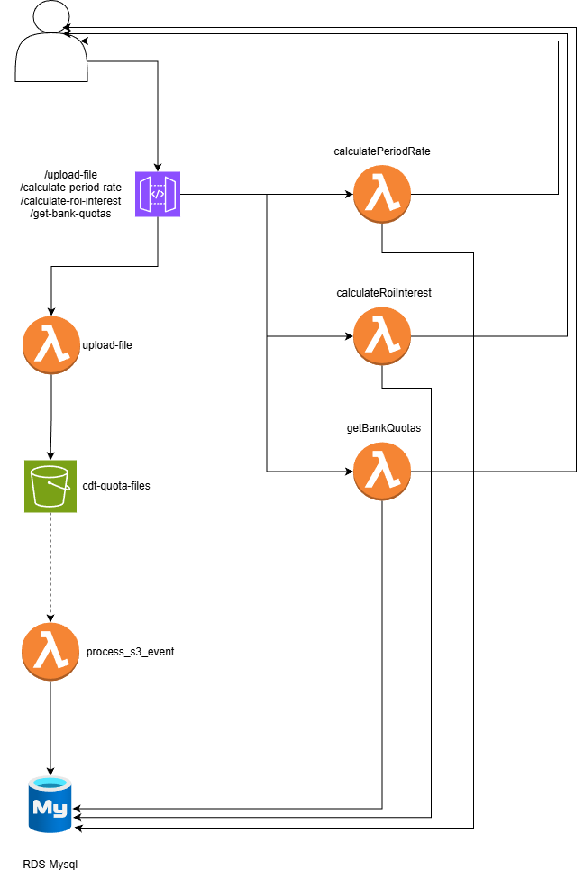

REP_RATE_CALCULATOR_API_CDT
===========================

API Serverless (AWS) para calcular tasas y ROI, cargar archivos de cuotas y exponer endpoints REST.

Arquitectura rapida
-------------------
- AWS Lambda + API Gateway definidas en serverless.yml (runtime python3.12).
- Base de datos MySQL consumida via pymysql.
- S3 para almacenar y procesar archivos CSV con tasas.
- Lambdas: uploadFile (POST /upload-file), processFile (trigger S3), calculatePeriodRate (POST /calculate-period-rate), calculateRoiInterest (POST /calculate-roi-interest), getBankQuotas (POST /get-bank-quotas).

Estructura del repo
-------------------
- app/LMD_*: manejadores Lambda.
- shared/: config, utilidades, validadores y repositorios de BD.
- tests/: unit tests y pruebas de integracion opcionales.
- serverless.yml: definicion de funciones y permisos.

Requisitos previos
------------------
- Python 3.12
- Node 18+ y Serverless CLI (npm i -g serverless)
- Credenciales AWS configuradas para la cuenta/rol deseado

Instalacion rapida (PowerShell)
--------------------------------
```powershell
python -m venv .venv
.\.venv\Scripts\Activate.ps1
pip install -r requirements.txt
npm install
```

Variables de entorno (.env)
---------------------------
Ejemplo minimo:
```env
DEFAULT_ENV=dev
DB_HOST=localhost
DB_PORT=3306
DB_USERNAME=root
DB_PASSWORD=pass
DB_NAME=db_rates
S3_BUCKET_NAME=dev-cdt-quota-files
MAX_FILE_SIZE_MB=5
ALLOWED_FILE_EXTENSIONS=.csv
CSV_DELIMITER=;
```
Para correr integraciones, agrega `RUN_DB_TESTS=1`.

Ejecutar pruebas
----------------
- Unit tests (sin BD):
```powershell
python -m unittest discover -s tests -p "test_*.py" -v
```
- Integracion con BD real (requiere RUN_DB_TESTS=1 y credenciales/DB listas):
```powershell
$env:RUN_DB_TESTS=1; python -m unittest tests.test_calculate_roi_integration -v
```

Despliegue
----------
```powershell
serverless deploy --stage <stage> --force
```
Usa variables del .env a traves de serverless-dotenv-plugin.
Todo se provisiona con Serverless Framework (API Gateway, Lambdas, IAM y bucket S3 para los uploads). El bucket de S3 se crea por stage usando `S3_BUCKET_NAME`.

Base de datos
-------------
- Motor: MySQL (deben configurar credenciales para conectarse, sin embargo, se adjunta un diagrama de su estructura.).
- Este repositorio no incluye el DDL; incorpora tus scripts de creacion/migraciones (ej. docs/db/schema.sql) antes de desplegar para tener las tablas de rates y files.

Endpoints y payloads
--------------------
- Base URL prod: https://h1rmyklr68.execute-api.us-east-1.amazonaws.com/prod
- POST /upload-file → multipart/form-data con CSV; guarda en S3 (uploads/) y crea registro en BD.
- S3 trigger /processFile → procesa CSV, valida columnas, actualiza tasas en BD y estados del archivo.
- POST /calculate-period-rate → { "annual_effective_rate": "0.12", "period_frequency": 12 } devuelve tasa vencida y porcentaje.
- POST /calculate-roi-interest → { "amount": "5000000", "term_in_days": "90", "base_days_in_year": 360 } devuelve ROI calculado por banco.
- POST /get-bank-quotas → { "amount": "5000000", "term_in_days": "90" } devuelve cuotas por banco para el rango.

**Postman Collection:** Importa la colección completa desde [docs/postman/BUSINESS_CASE_BEST_CDT_COLLECTION.postman_collection.json](docs/postman/BUSINESS_CASE_BEST_CDT_COLLECTION.postman_collection.json) para probar todos los endpoints.

Ejemplos de consumo (cURL)
--------------------------
- Subir CSV
```bash
curl -X POST "https://h1rmyklr68.execute-api.us-east-1.amazonaws.com/prod/upload-file" \
	-H "Content-Type: multipart/form-data" \
	-F "file=@./rates.csv;type=text/csv"
```

- Calcular tasa vencida
```bash
curl -X POST "https://h1rmyklr68.execute-api.us-east-1.amazonaws.com/prod/calculate-period-rate" \
	-H "Content-Type: application/json" \
	-d '{
		"annual_effective_rate": "0.12",
		"period_frequency": 12
	}'
```

- Calcular ROI por banco
```bash
curl -X POST "https://h1rmyklr68.execute-api.us-east-1.amazonaws.com/prod/calculate-roi-interest" \
	-H "Content-Type: application/json" \
	-d '{
		"amount": "5000000",
		"term_in_days": "90",
		"base_days_in_year": 360
	}'
```

- Consultar cuotas por rango
```bash
curl -X POST "https://h1rmyklr68.execute-api.us-east-1.amazonaws.com/prod/get-bank-quotas" \
	-H "Content-Type: application/json" \
	-d '{
		"amount": "5000000",
		"term_in_days": "90"
	}'
```

Flujo de carga de tasas
-----------------------
1) uploadFile recibe CSV y lo sube a S3.
2) processFile (evento S3) valida estructura, carga tasas en BD y marca todos los estados del archivo.
3) En caso de encontrar tasas con valores inconsistentes o plazos mal parametrizados el sistema los ignora y adjunta advertencias sobre los consecutivos cargados.

Notas rapidas
-------------
- Credenciales y conexion a BD se leen desde shared/config.py.
- Los archivos CSV deben cumplir columnas en Config.FILE_REQUIRED_COLUMNS y delimitador CSV_DELIMITER.

Diagrama arquitectura
-------------


---

REP_RATE_CALCULATOR_CLIENT_CDT
==============================

Cliente web (frontend) desarrollado en Angular 18 con Tailwind CSS. Consume la API REST para realizar cálculos de tasas, ROI, cargas de archivos y gestión de historial.

**URL de acceso (Producción):** https://prod.d3sk51crxgv08l.amplifyapp.com/

Características
---------------
- **Componentes modulares standalone**: Calculadora de ROI, tasa por periodo, cuotas bancarias, carga de archivos.
- **Tabla de historial dinámico**: Visualiza últimos registros de carga con estados y toggle de visibilidad.
- **Modal de detalles**: Muestra alertas y validaciones de archivos cargados.
- **JSON Viewer**: Copia y descarga respuestas de API en formato JSON.
- **Estilos Tailwind CSS**: Responsive y moderno.
- **Integración CORS**: Configurado para consumir API en prod.

Estructura del cliente
---------------------
```
src/
├── app/
│   ├── components/
│   │   ├── roi-calculator/            # Cálculo de ROI por banco
│   │   ├── expired-period-calculator/ # Tasa por periodo
│   │   ├── bank-quotas-form/          # Cuotas bancarias
│   │   ├── file-upload/               # Carga de CSV
│   │   ├── rates-history/             # Tabla de historial
│   │   ├── rates-history-detail/      # Modal de alertas
│   │   └── json-viewer/               # Visualizador JSON
│   ├── services/
│   │   └── api.service.ts             # Llamadas a API REST
│   ├── environments/
│   │   ├── environment.ts             # Desarrollo
│   │   └── environment.prod.ts        # Producción
│   └── app.html / app.ts              # Componente raíz
├── assets/
└── styles/
    └── styles.css                      # Tailwind + custom
```

Requisitos previos (Cliente)
----------------------------
- Node.js 18+ y npm
- Angular CLI: `npm i -g @angular/cli`

Instalación (PowerShell)
------------------------
```powershell
cd REP_RATE_CALCULATOR_CLIENT_CDT
npm install
```

Variables de entorno (Cliente)
-----------------------------
Edita `src/environments/environment.ts` (dev) y `environment.prod.ts` (prod):
```typescript
export const environment = {
  apiBaseUrl: 'https://h1rmyklr68.execute-api.us-east-1.amazonaws.com/prod'
};
```

Desarrollo local (Cliente)
--------------------------
```powershell
ng serve --open
# App corre en http://localhost:4200
```

Build para producción (Cliente)
-------------------------------
```powershell
npm run build -- -c production
# Output: dist/REP_RATE_CALCULATOR_CLIENT_CDT/
```

Componentes principales (Cliente)
---------------------------------

### ROI Calculator
Calcula retorno de inversión ingresando monto, plazo y tasa base anual. Devuelve ROI por banco.

### Expired Period Calculator
Convierte tasa efectiva anual a tasa vencida por periodo (mensual, trimestral, etc.).

### Bank Quotas Form
Calcula cuotas de CDT por banco para un monto y plazo dados.

### File Upload
Sube archivos CSV (.csv máx. 5MB) con tasas. Valida formato y registra carga en BD.

### Rates History
Tabla con últimas cargas: ID, archivo, estado, errores, fecha, IP, alertas. Con botón para ocultar/mostrar tabla y recargar datos.

### Rates History Detail (Modal)
Muestra detalles de alertas para un archivo: rate consecutivo, tipo alerta, mensaje, fecha.

### JSON Viewer
Componente reutilizable para mostrar respuestas JSON con botones copiar y descargar.

Servicios (Cliente)
-------------------
**api.service.ts**: Centraliza llamadas HTTP a la API.
- `getUploadHistory()`: Obtiene últimas cargas.
- `calculateRoiInterest()`: POST /calculate-roi-interest.
- `calculatePeriodRate()`: POST /calculate-period-rate.
- `getBankQuotas()`: POST /get-bank-quotas.
- `uploadFile()`: POST /upload-file (multipart).

Despliegue en AWS Amplify (Cliente)
-----------------------------------

### Opción 1: Amplify CLI
```powershell
npm install -g @aws-amplify/cli
amplify init
amplify add hosting
# Selecciona "Hosting with Amplify Console" > "Manual deployment"
amplify publish
```

### Opción 2: Amplify Console (manual)
1. Ve a [AWS Amplify Console](https://console.aws.amazon.com/amplify/).
2. Clic en **Create app** → **Deploy without Git**.
3. Sube el contenido de `dist/REP_RATE_CALCULATOR_CLIENT_CDT/`.
4. Amplify provisiona hosting y proporciona URL pública.

### Configurar rewrites para SPA
Después de subir, en Amplify Console:
1. App settings → **Rewrites and redirects**.
2. Agrega: Source `</^((?!\\.).)*$/>` → Target `/index.html` (Type: 200 Rewrite).
3. Guarda y espera ~1 minuto.

Manual de usuario (Cliente)
---------------------------
1. **Cargar archivo**: Sección "Cargar archivo" → selecciona CSV y envía.
2. **Calculadoras**: Completa campos en tarjetas y pulsa "Calcular".
3. **Historial**: En "Historial de cargas", ve últimas operaciones y usa ojo para ocultar/mostrar tabla.
4. **Alertas**: Si hay advertencias, presiona "Ver" en la tabla para abrir modal con detalles.
5. **JSON**: Las respuestas de API se pueden copiar o descargar con el viewer.

Herramientas y librerías (Cliente)
----------------------------------
- **Angular 18**: Framework SPA.
- **Tailwind CSS**: Estilos responsive.
- **RxJS**: Manejo de Observables para HTTP.
- **HttpClient**: Consumo de API REST con CORS.